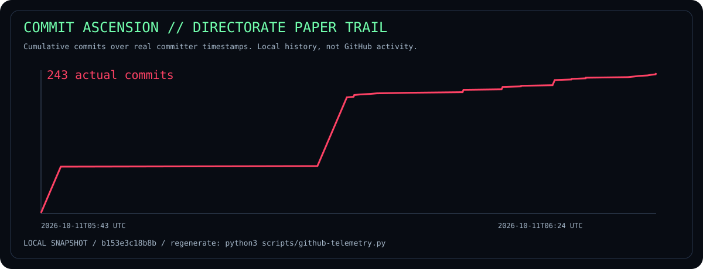
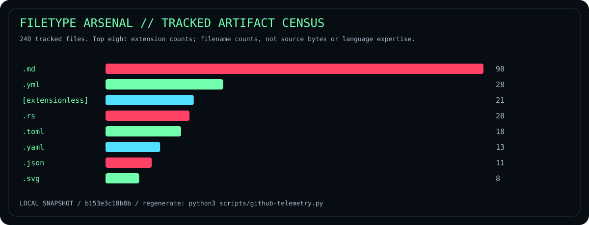
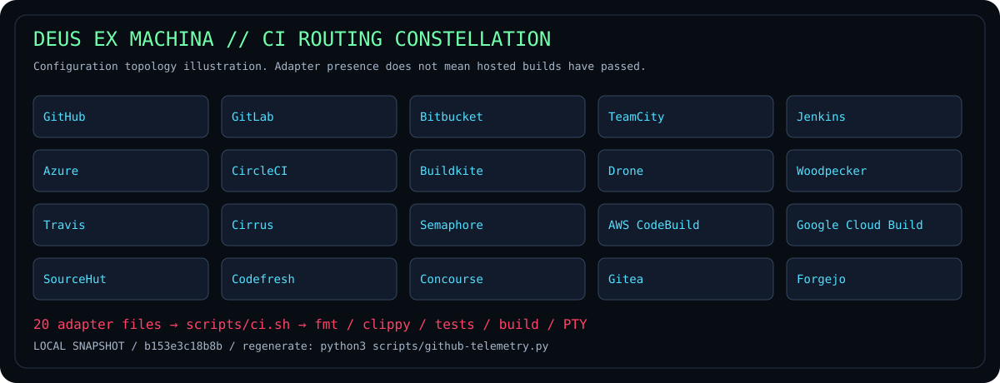

# GITHUBS // THE ORNAMENT DIRECTORATE

**CLEARANCE ABYSS-999 · STAR CHAMBER · TWEETER × KRILLION**

The fictional directorate has commandeered the entire badge budget. This annex collects
popular README ornaments, original offline charts, and public-account embeds. Repository
URLs use the anticipated `darkhappy/opsec-demon` slug. There is no configured Git remote;
repository cards may report missing data until publication. Profile cards show `darkhappy`
account activity, not shell usage or shell performance. Hosted images can be cached or unavailable.

[Main operating manual](README.md) · [Source reconnaissance](docs/github/SOURCES.md) ·
[Embed URL manifest](docs/github/embeds.json) · [Metrics methodology](METRICS.md)

## BADGE SATURATION // MAXIMUM PHOSPHOR

Dynamic badges report the provider's GitHub data. A missing release, absent hosted build,
or unpublished repository may produce `not found`, `no status`, or another provider message.
Static labels describe local features or explicitly fictional clearance; they are not certifications.

## OFFLINE CHART ROOM // ACTUAL LOCAL RECORDS

These charts are generated from the revision recorded in [the local snapshot](docs/github/local-telemetry.json).
The CI map is a configuration illustration. Regenerate with `python3 scripts/github-telemetry.py`;
commit the changed snapshot and each changed SVG separately. Later documentation commits
are intentionally not retroactively included in a saved snapshot.

## STAR CHAMBER // REPOSITORY TELEMETRY

### Calendar star history

### Aligned star timeline

[Open the star dashboard](https://www.star-history.com/?repos=darkhappy%2Fopsec-demon&type=date).
Star counts measure GitHub interest, not security, speed, audio quality, or user count.

## FOREIGN CONSTELLATIONS // POPULAR REPOSITORY REFERENCES

These are other projects' public star histories, shown as README design references.
They do not represent OPSEC DEMON adoption or a performance comparison.

Sources: [fish](https://github.com/fish-shell/fish-shell), [Starship](https://github.com/starship/starship),
[fzf](https://github.com/junegunn/fzf), [bat](https://github.com/sharkdp/bat),
[Shields](https://github.com/badges/shields), [Star History](https://github.com/star-history/star-history),
[Typing SVG](https://github.com/DenverCoder1/readme-typing-svg).

## OPERATOR DOSSIER // ACCOUNT CARDS

Stats cards use [GitHub Stats Extended](https://github.com/stats-organization/github-stats-extended),
the successor linked by [GitHub Readme Stats](https://github.com/anuraghazra/github-readme-stats).
[Streak Stats](https://github.com/DenverCoder1/github-readme-streak-stats),
[Activity Graph](https://github.com/Ashutosh00710/github-readme-activity-graph),
[Profile Trophy](https://github.com/ryo-ma/github-profile-trophy), and
[the image-request counter](https://github.com/antonkomarev/github-profile-views-counter)
provide the remaining cards. Image-request counts can increase through bots, caches,
or repeated loads. No fabricated contribution totals or stars are stored locally.

## TOOL LOGO ARMORY

[Skill Icons](https://github.com/tandpfun/skill-icons) identifies configured tool families.
Icons do not imply that every IDE, provider, or hosted environment was tested.

## ADDITIONAL ORNAMENT PROCUREMENT

| Ornament | Upstream | Setup before embedding |
| --- | --- | --- |
| Animated contribution snake | [Platane/snk](https://github.com/Platane/snk) | Generate your own SVG from account data, then commit it or publish to an output branch. |
| Rich metrics infographic | [lowlighter/metrics](https://github.com/lowlighter/metrics) | Configure the generator and its selected data sources; keep credentials in Actions secrets. |
| Summary and productive-time cards | [Profile Summary Cards](https://github.com/vn7n24fzkq/github-profile-summary-cards) | Generate card files for the intended account. |
| Profile layout assembly | [README Generator](https://github.com/rahuldkjain/github-profile-readme-generator) | Assemble a profile and replace its example identity. |
| More gallery specimens | [Awesome Profile READMEs](https://github.com/abhisheknaiidu/awesome-github-profile-readme) | Browse layouts and credit upstream assets you reuse. |

These generators are catalogued rather than pointing at another user's contribution snake
or claiming a nonexistent coverage report. Coverage, Codecov, package downloads, OpenSSF,
container registry pulls, WakaTime, and deployment status should be added when their actual
service or package has been configured. The shell currently ships no crates.io package.

## RETARGET THE RELAY

Change the repository slug and account in `docs/github/embeds.json`, then update matching
URLs in this annex, the badge snippet, and the main README. Keep the repository identity
separate from the account identity. Use a public image URL for an embed, not a dashboard
HTML page. GitHub READMEs display images and Mermaid; arbitrary JavaScript dashboards and
iframes will not function there. The original local SVGs remain usable offline.

The directorate's final requisition: **more phosphor, zero invented evidence.**
