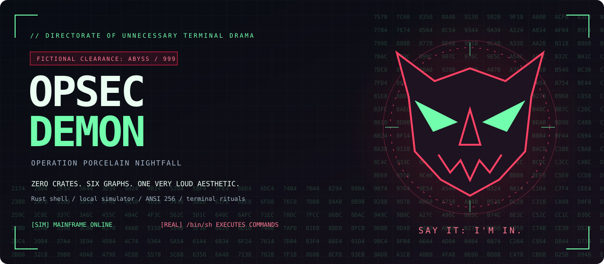
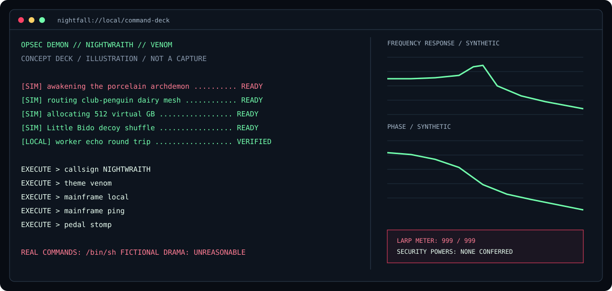
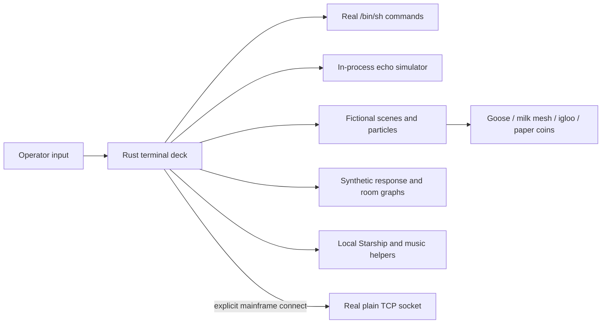

<div align="center">



# OPSEC DEMON

### OPERATION PORCELAIN NIGHTFALL · CLEARANCE ABYSS-999

**A zero-dependency Rust shell for operators whose terminal needs a fictional intelligence budget.**

[](Cargo.toml)
[](Cargo.lock)
[](LICENSE)
[](.opsec-dossier.toml)
[](#drive-the-command-deck)

[](https://github.com/darkhappy/opsec-demon/actions/workflows/ci.yml)
[](https://github.com/darkhappy/opsec-demon/stargazers)
[](https://github.com/darkhappy/opsec-demon/forks)
[](https://github.com/darkhappy/opsec-demon/issues)
[](https://github.com/darkhappy/opsec-demon/commits/main/)
[](https://github.com/darkhappy/opsec-demon)

**[Enter the deck](#build-and-enter) · [Operator archive](docs/README.md) · [Contribute](CONTRIBUTING.md) · [Actual boundaries](SECURITY.md)**

</div>

> [!NOTE]
> **All clearance levels, intelligence agencies, and OPSEC superpowers on this page are fiction.**
> The shell runs real commands. The theater does not grant anonymity or protect your machine.
> Repository badges target the anticipated `darkhappy/opsec-demon` GitHub slug; they become live
> when a repository exists there. No remote or publication is configured by these docs.

---

## THE DIRECTORATE HAS AUTHORIZED EXCESSIVE VIBES

You have entered the basement of a fictional intelligence agency whose entire infrastructure
budget was spent on terminal phosphor, a cursed SSD, and a goose egg. Somewhere in the
ventilation system, a drummer has exploded into ASCII and is politely reassembling himself.
The dairy mesh has achieved butter consensus. Club Penguin is the imaginary offsite bunker.
Little Bido is performing a decoy shuffle that has absolutely no effect on your IP address.

The mission: launch an actual Rust shell, watch a fifteen-second cinematic, verify the local
worker echo, and say **I'M IN** with the confidence of a man who has just discovered `pwd`.

| Directorate asset | Actual behavior | Fictional designation |
| --- | --- | --- |
| Zero-crate Rust engine | Standard library and Unix terminal facilities | BLACKSITE FORGE |
| Command deck | Real `/bin/sh` subprocesses and an animated transcript | NIGHTWRAITH UPLINK |
| Matrix rain | Decorative terminal animation | SIGNAL VEIL |
| Local mainframe | In-process worker echo | ABYSS RELAY |
| Response graphs | Synthetic signal and room models | SPECTRAL AUDIT |
| 512 GB expansion | Virtual allocation bookkeeping | VULCAN SOUL BANK |
| Club-penguin bucket | Session-only in-memory objects | IGLOO ARCHIVE |
| Paper coins | Fictional session ledger | PORCELAIN TREASURY |
| Music bridge | Local now-playing metadata | AUXILIARY VIBE INTELLIGENCE |



*Original SVG concept artwork. For the actual interface, build and launch the terminal app.*

<details open>
<summary><strong>OPEN THE ABYSS DOSSIER // seven-minute operator orientation</strong></summary>

```sh
mise install
mise run build
mise exec -- ./target/release/opsec-demon --nerd-font --mo-krill --egg
```

Select a compatible Nerd Font if enabling icons. `mise run font` installs the documented
font; terminal font selection is still yours. Then enter these supported built-ins:

```text
callsign NIGHTWRAITH
theme venom
mainframe local
mainframe ping
pedal stomp
bucket put briefing.txt "the igloo has fallen upward"
bucket sync
tailscale churn
expansion expand
expansion allocate 128
oracle
```

**Extraction:** Ctrl-D. **Particle escalation:** Ctrl-X. **Graph rotation:** Ctrl-F.
**Emergency full shell:** `shell`. **Skip the cinematic:** launch with `--instant`.

</details>

## CLASSIFIED ARCHITECTURE, UNCLASSIFIED SOURCE CODE



> [!TIP]
> Set a terminal near **120 columns × 40 rows** for the large deck. At smaller sizes,
> the interface adapts and cycles panels. The render loop targets about 30 FPS.

<details>
<summary><strong>DECLASSIFY THE PROP INVENTORY // bureaucratic excess annex</strong></summary>

- **Operation Little Bido:** a three-second fictional packet sidestep; no packets required.
- **Tailscale Milk:** imagined cow nodes, butterstorm protocol, lactose-based routing mythology.
- **Mo & Krill:** original ASCII tribute; no game client integration.
- **Porcelain Archdemon:** poopsec mode, sewer lore, total absence of actual counterintelligence.
- **Cursed Apple:** rotating ritual states, imaginary patron whispers, zero summoning dependencies.
- **Golden Goose:** session souls, a timed hatch, and simulated buffs that die with the process.
- **VULCAN bank:** 512 virtual GB, no hardware allocation, maximum spreadsheet intimidation.
- **Imaginary eBay SSD:** invented cartoon explosion odds; no hardware inspection.
- **Phantom SDVX:** keyboard buttons, knobs, pretend scoring, confetti jurisdiction.
- **Country command room:** fictional focus timers with no real strategy-game control.
- **Beatles tribute:** silent ASCII band, periodically reconstructed cartoon drummer.
- **Paper treasury:** no blockchain, exchange, wallet, or financial asset.

</details>

<details>
<summary><strong>DECLASSIFY THE GIT INITIALIZATION CEREMONY</strong></summary>

This archive uses `main`, a tracked MIT license, normalized line endings, editor and optional
Prettier settings, pinned mise tasks, CI, issue forms, and a ludicrous `.gitignore` dossier.
`AGENTS.md` requires a non-empty commit for every atomic change. The generated API-shaped
comment is unused entropy. `.opsec-dossier.toml` is a prop; the program does not load it.

If publishing to a GitHub repository you own, create the destination first, then configure
its actual URL as your remote and push `main`. The local archive does not provision hosting.

```sh
git status
git log --format='%h %aI %s'
git remote -v
```

</details>

## FIELD MANUAL // ACTUAL OPERATING INSTRUCTIONS


A Rust shell with a full-screen hacker theater dashboard: Matrix rain, ASCII
mascots, dancing particle explosions, a simulated command feed, and four animated
signal-response graphs and a modeled room-decay curve. It has zero crate
dependencies. Real commands run through
`/bin/sh`; the theatrical boot commands are clearly marked `SIM` and never execute.
This is an aesthetic, not a security or anonymity boundary.

## Build and enter

```sh
mise install
mise run build
mise run font
# Select JetBrainsMono Nerd Font Mono in your terminal's font settings.
mise exec -- ./target/release/opsec-demon --nerd-font --mo-krill --egg
```

Rust is pinned to 1.93.1 and [Starship to 1.26.0](https://github.com/starship/starship/releases/tag/v1.26.0). The font task downloads the official Nerd Fonts 3.5.1
JetBrains Mono archive and verifies its published SHA-256 before installing it for
your user. Named stages report the actual download, checksum, extraction, font
copy, and cache work; the build task likewise reports compiler, build, and binary
stages. These installation messages follow real operations. macOS uses `~/Library/Fonts`; Linux uses your XDG data directory. It does
not change your terminal's selected font. Plain ASCII works without a Nerd Font;
`--nerd-font` or `icons on` enables the extra icons. `doctor` reports the terminal,
font mode, and local music configuration. Tool and font installation need network
access. If Rust is already installed, `cargo build --release` builds directly.

The dashboard fills the current terminal and adapts when resized. Use a window
around 120 columns by 40 rows to see all four graphs together; smaller windows
cycle one graph with Ctrl-F, and very small windows retain a compact command deck.
The render loop targets about 30 frames per second. A modern terminal such as
[Kitty](https://sw.kovidgoyal.net/kitty/index.html) works on macOS and Linux; font
choice and window size matter more than switching terminals for these ASCII
effects. There is no hidden terminal-specific animation tier.

The default interactive boot lasts **15 seconds**. A full-screen Matrix sequence
streams randomized fictional commands while telemetry and graphs gradually come
online. Eight named stages have their own progress bars and fictional archive
paths, from loading the terminal driver through assembling the mainframe route.
The command stream runs at about twelve simulated commands per second. At completion, the local simulator establishes an actual in-process echo
round trip, the terminal bell rings once, and the screen cues
**SAY IT OUT LOUD: I'M IN.** A radial explosion and three-second flash, shockwave, fade, and scan reveal
transition into the live deck. Bell sound depends on terminal settings. Ctrl-D aborts
boot; `--instant` or `--no-banner` skips it. `cinematic` replays the sequence.

## Drive the command deck

Most commands run inline: their output scrolls through the transcript while the
animations continue. Ctrl-C cancels the active child command. Use `shell COMMAND`
for interactive programs such as `shell ssh user@host` or `shell vim file.txt`;
the terminal returns to normal input until the program finishes, then Enter brings
you back to the deck. Input supports cursor editing and history, with a 4,096-byte
limit. Tab completes built-ins, executables on PATH, and file/directory names;
it extends shared prefixes and lists ambiguous choices. Completion understands
quoted paths, escapes spaces, replaces the current word when the cursor is in
its middle, and caps scans and suggestions. Session `PATH` and `HOME` overrides
also apply to completion. Directory matches keep their trailing slash for the
next Tab press. Up/Down navigate command history. There is no job control. Change colors with `theme crimson`, `theme ghost`, or `theme venom`.

| Key | Action |
| --- | --- |
| Enter | Run the command |
| Left / Right, Home / End, Ctrl-A / Ctrl-E | Move the input cursor |
| Up / Down | Recall session history |
| Backspace, Ctrl-U | Delete before the cursor / clear input |
| Ctrl-C | Cancel the active child command and clear input |
| PgUp / PgDn | Scroll the transcript |
| Ctrl-L / Ctrl-P | Connect the local simulator / verify its echo |
| Ctrl-B | Toggle poopsec |
| Ctrl-T | Toggle demon and Mo & Krill |
| Ctrl-X | Trigger a particle explosion |
| Ctrl-G | Stomp the fictional effects pedal |
| Ctrl-F | Cycle the response graph |
| Ctrl-N | Advance the fictional mission |
| Tab | Complete commands and file paths |
| Ctrl-D | Exit and restore the terminal |

Colors use the full ANSI **256-color palette**, meaning 8-bit color indices.
`--plain` or `NO_COLOR=1` removes colors; the TUI still uses cursor-control codes.
Normal exits and handled errors restore the terminal. If forcibly killed, run
`stty sane` to restore input.

## Working directory, Starship, and Kubernetes context

The command footer shows your actual working directory and a prompt from the
installed Starship executable. Launch through `mise exec --` to put the pinned
binary on PATH, or activate mise in your parent shell. Starship receives the
current directory, previous exit status, and terminal width; its modules follow
your `~/.config/starship.toml` or `STARSHIP_CONFIG`. The TUI flattens multiline
output and removes ANSI escapes while retaining icons, using its own dashboard
palette. This integration calls Starship directly; it does not source a shell's
Starship initialization script.

Prompt work runs off the rendering thread and refreshes when context changes or
every two seconds, with bounded subprocess timeouts. When Starship is unavailable,
the footer falls back to the current directory and locally detected Git branch.
An independent `[k8s: CONTEXT]` reads `kubectl config current-context` from your
local kubeconfig, honoring `KUBECONFIG`; it makes no cluster request. Missing or
unavailable context appears as `-`. Starship's own Kubernetes module is
[disabled by default](https://starship.rs/config/#kubernetes); enable it in your
Starship config if you also want it in the rendered prompt:

```toml
[kubernetes]
disabled = false
```

```text
cd "directory with spaces"
cd -
export DEMON_CALLSIGN=NIGHTWRAITH
printf '%s\n' "$DEMON_CALLSIGN"
unset DEMON_CALLSIGN
```

Standalone `export` and `unset` persist overrides for later child commands and
prompt helpers. `cd -` returns to the previous directory. Ordinary commands still
run in individual `/bin/sh` processes: aliases, shell functions, and variables
created only inside one child do not automatically persist in this deck. Use
`shell` to open the native shell named by `$SHELL`, or `shell bash` /
`shell zsh` for a specific full interactive shell, including its startup
configuration and job control. Output has a larger wrapping transcript, with
PgUp/PgDn scrollback, while the animation panels keep moving.

## Choose your larp

```text
callsign NIGHTWRAITH
theme venom
mascot mo-krill
mascot chinese-demon
mode prostreet
mode vulcan
mode demon
poopsec on
bido
tailscale milk
tailscale routes
tailscale churn
mission next
oracle
dossier
```

`mascot mo-krill` deploys an original ASCII tribute to
[Mo & Krill](https://deadlock.wiki/Mo_%26_Krill). `mascot chinese-demon` summons a
Chinese-inspired fantasy demon mask. Explosions dance through the neon scene,
with Filipino larp flavor in the fictional transmissions. `poopsec` swaps in the
porcelain archdemon and sewer lore. `mode prostreet` adds a Need for Speed
ProStreet-inspired ASCII racing scene; `mode vulcan` displays the TEAMGROUP
T-FORCE VULCAN Z memory-bank scene. These are fictional visual modes, not game or
hardware integrations. Launch directly with `--chinese-demon`, `--prostreet`,
`--vulcan`, or `--poopsec`; `--mcp-expansion` enables the virtual bank at startup.

Little Bido Technique is an invented three-second decoy shuffle and tiny packet
sidestep. Tailscale Milk is a fictional dairy mesh with cow-node, mainframe, and
club-penguin peers; `tailscale churn` starts a three-second butterstorm. Neither
feature sends packets or requires a Tailscale installation.

Callsigns accept 24 ASCII letters, digits, underscores, and hyphens. Successful
commands advance your fictional rank. `mission` shows the current story act;
`mission next` advances it manually. Persona, history, and simulated game state
last for the current process only.

## Silent band, effects pedal, and headphone profiles

The normal right panel shows an original Beatles ASCII tribute and the SDVX
controller together at 44 rows or taller. Shorter layouts rotate those views.
The band starts enabled, with a cartoon drum-solo explosion every 25 seconds;
the drummer reassembles from ASCII ashes after three seconds. These animations
are silent.

```text
band status
band off
band on
band drummer explode
pedal stomp
pedal release
pedal status
headphones list
headphones select ath-r70xa
headphones select hd58x
headphones status
graph headphones
```

Ctrl-G also stomps the pedal, triggers dancing particles, and adds 15 to the
fictional larp meter, capped at 999. Release raises the pedal without resetting
that meter. The headphone selector labels Audio-Technica ATH-R70xa or
Sennheiser x Massdrop HD58X Jubilee; the ATH-R70xa profile is initially selected.
`graph headphones` displays the selected profile's invented frequency-gain
curve. These are decorative examples, without measured headphone responses,
EQ recommendations, audio output, device detection, or hardware configuration.

## Country command room

`hoi4 list` opens a fictional strategy-game country selector. Choose Germany
(GER), USSR (SOV), USA (USA), UK (ENG), France (FRA), Italy (ITA), Japan (JAP),
Poland (POL), China (CHI), or the Philippines (PHI). `UK` and `USSR` are also
accepted aliases; the Philippines is selected initially.

```text
hoi4 select PHI
hoi4 focus ARCHIPELAGO OVERDRIVE
hoi4 status
```

A focus runs for twenty real seconds while the deck animates, then reports an
imaginary doctrine unlock. Names accept up to 64 printable ASCII characters;
`hoi4 focus` uses the selected country's default invented focus. Switching
countries cancels the active focus and resets the completion counter.
This is local roleplay, without real HOI4 rules, historical simulation, or effects
on an installed game.

## Mainframe connection

The built-in local simulator connects after boot. `mainframe ping` verifies its
worker echo round trip; `mainframe local` reconnects it. No socket is needed for
the simulator.

```text
mainframe local
mainframe ping
mainframe connect 127.0.0.1:9000
mainframe disconnect
```

A remote connection needs a numeric IP and port for a service you already run;
IPv6 uses `[::1]:9000`. It opens a plain TCP socket with a three-second connection
timeout, without TLS, authentication, or a remote shell protocol. An open socket
does not verify the remote application. Simulator ping does not send its protocol
to remote services. Use `shell ssh user@host` for an actual remote login.

## Signal graphs and music

Frequency response, unwrapped phase, group delay, and excess group delay share a
synthetic resonant low-pass model with an added transport delay. Axes use Hz,
dB, degrees, and milliseconds. Excess group delay removes the model's
minimum-phase contribution, leaving the added transport delay. These are coherent
simulated diagnostics, not measurements of the track playing on your computer.
A fifth graph shows idealized room RT60 decay; `graph room` selects it, and Ctrl-F
or `graph next` cycles all six, including the headphone example curve. Configure it with `rt60 set 5 4 3 0.2`
(width, length, height in meters, then mean absorption). `rt60 status` prints the
result; `room` is an alias. Sabine RT60 is `0.161 × volume / (surface × absorption)`;
the curve reaches -60 dB at that time. Defaults produce about 0.514 seconds.
Dimensions range from 0.1 to 1,000 meters, absorption from 0.001 to 1. This is a
single broadband diffuse-field model, without microphones, playback, or audio I/O.

The music line reads local playback off the render thread every two seconds:
macOS uses the Music app via `osascript`; Linux uses `playerctl` with an
MPRIS-compatible player. macOS may request Automation permission to read Music.
If no supported player is active, the panel says so. `music demo` explicitly shows
a demo track; `music live` restores local telemetry; `music status` prints it.

No Apple API key is bundled or generated. Apple personalized API requests require
a signed developer token and Music User Token. `APPLE_MUSIC_DEVELOPER_TOKEN` and
`APPLE_MUSIC_USER_TOKEN` are recognized only for redacted configuration status;
their presence is unverified and this build never sends them to Apple. Local
now-playing needs neither token. Apple's recently-played REST endpoint is history,
not live playback. See Apple's [MusicKit authentication documentation](https://developer.apple.com/documentation/applemusicapi/user-authentication-for-musickit)
and [developer token guide](https://developer.apple.com/documentation/applemusicapi/generating-developer-tokens).

For the **Windows Apple Music app from WSL**, install and start the included
read-only Windows media-session to MPRIS bridge from a normal WSL terminal:

```sh
bash scripts/setup-windows-music.sh
playerctl -p AppleMusicWindows metadata --format '{{status}} | {{artist}} - {{title}}'
```

The setup uses the already installed `playerctl` and Ubuntu's `python3-gi`
(`sudo apt install playerctl python3-gi` if missing), plus Windows PowerShell
through WSL interop. It enables a systemd user service that polls Windows once
per second, exposing title, artist, album, and Playing/Paused/Stopped status as
`AppleMusicWindows`. The dashboard's existing `music live` integration sees this
MPRIS player; other active Linux players may take precedence in plain `playerctl`.
This targets the native Windows app's AppleMusic session, not browser playback.
It does not send playback controls, expose artwork or position, or require Apple
tokens, a network listener, or Windows package installation. Windows 10 version
1809 or later is required by the Windows media-session API.

Use `journalctl --user -u windows-music.service -n 30` for errors and
`systemctl --user disable --now windows-music.service` to stop and disable it.
If systemd user services are unavailable, run
`/usr/bin/python3 scripts/windows-music.py` in a separate terminal. Both the
bridge and consumers must share a D-Bus session; `dbus-run-session -- bash` can
provide one for apps launched from that shell. For scripts that only need JSON,
`/usr/bin/python3 scripts/windows-music.py --json` streams playback directly
without D-Bus. Closing Apple Music clears metadata; a stalled reader clears it
after eight seconds. The service restarts the reader after failures.

## Cursed Apple and Golden Goose Egg

```text
ritual
egg start
egg status
egg hatch
```

The fictional Cursed Apple ritual changes phase every 20 seconds, cycling sigils,
soul conduit, patron whispers, veil fracture, summoning, and ward reset. It calls
no Deadlock service.

The [Golden Goose Egg](https://deadlock.wiki/Golden_Goose_Egg) simulation starts
with a 2,400-soul wallet. An egg costs 800 souls, carries 400 initial souls, earns
80 per real minute, and grants one random permanent session buff per 80 earned
souls. Initial souls grant no buffs. While carrying, its simulated stats are
**-15% damage, +1m sprint speed, and +1 out-of-combat regeneration**. `egg hatch`
starts a nonblocking two-second channel, then pays out and removes the carrying
stats. Five minutes earns 800 souls and five buffs; buffs persist through later
egg purchases in this session. Weighted draws approximate the documented buff
frequencies; session ages of 10 and 30 minutes stand in for match-age scaling.
Nothing affects a real Deadlock match. `--egg` starts carrying at launch.

## Club-penguin bucket and 512 GB expansion

```text
bucket ls
bucket put igloo.txt "dance floor online"
bucket get igloo.txt
bucket sync
bucket rm igloo.txt
expansion expand
expansion allocate 128
expansion release 64
expansion status
```

The club-penguin B2 bucket stores objects in memory only. Fake sync narrates an
imaginary igloo relay without network traffic. Limits are 100 objects, 4,096 bytes
per object, and 128-character printable ASCII names without slashes or traversal.
Object reads escape terminal control characters.

The MCP expansion simulator enables **512 virtual GB** of bookkeeping with
T-FORCE VULCAN Z branding. Whole-number allocations and releases enforce available
capacity. Repeating `expand` preserves usage. This allocates no real RAM, changes
no MCP server, and makes no claim about hardware capacity. All simulation state
resets when the shell exits.

## Conclave combat worksheet

`..advancedttk` reads a bounded JSON setup. `mode` is an ordered list of
**one-based weapon indices** into `events`: `[1,2,2]` fires weapon 1 once,
then weapon 2 twice. Entries outside `1..events.len()` are rejected. The exact
original payload resolves to Vectis Prime → Lex Prime → Lex Prime. Without a
`calculation` policy it displays the setup while leaving target/hit interpretation
unselected.

To evaluate that finite shot sequence, add `"calculation":"sequence-body"` or
`"calculation":"sequence-head"`. These explicit policies interpret `-ehp` as
**health, shield, armor**. Supply the assumed switch duration with numeric
`"swap_ms"`; without it, timing excludes weapon switching and is a firing-only
lower bound, rather than a complete TTK.

```text
..advancedttk {"events":["vectis prime -mod 20 impact","lex prime -mod 20 puncture"],"mode":[1,2,2],"target":"-ehp 195 125 175","calculation":"sequence-body","swap_ms":500}
```

The sequence carries remaining shield and health between shots, respects each
weapon's firing cooldown and magazine, and stops at the killing shot. It does
not repeat automatically; if all listed shots leave the target alive, it reports
remaining health and no TTK. Reloads use an idealized automatic model that can
complete while holstered; `swap_ms` is user supplied, not verified game timing.

`"calculation":"individual-body"` or `"individual-head"` retains the separate
per-weapon estimates. The presets are historical Conclave wiki snapshots:
[Lex Prime](https://warframe.fandom.com/wiki/Conclave:Lex_Prime) and
[Vectis Prime](https://warframe.fandom.com/wiki/Conclave:Vectis_Prime), rather
than PvE damage values or live game telemetry. Head calculations use unscoped
weapon multipliers, without sniper zoom bonuses.

Conclave [retains the old Flesh/Ferrite/Shield system](https://wiki.warframe.com/w/Conclave).
The model applies typed armor mitigation, shot counts, magazine reload timing,
and proportional shield overflow. The first shot occurs at time zero. Conversion
mods redistribute physical damage rather than adding 20% total damage; their
names and intended effects appear in DE's [Update 17 patch notes](https://www.warframe.com/en/patch-notes/pc/17-0-0).
The implemented conversion assumption retains `(1-c)` of each damage component
and adds `c × total IPS` to the selected type, with `c` between 0 and 20%.

Results explicitly say **IDEALIZED MODEL ESTIMATE**. They exclude game damage
quantization, regeneration, misses, abilities, status, and falloff. In particular,
[Conclave research](https://forums.warframe.com/topic/952047-weapon-balance-pass-tools-for-weapon-comparison-and-paris-bug/)
reports damage quantization that can change actual breakpoints. The printed
assumptions and source links make the modeled result inspectable.

## Imaginary eBay SSD disaster

```text
ssd status
ssd roll
ssd explode
```

An IBM 1.8-inch 480GB SATA eBay prop has invented **4–10% cartoon explosion odds
per roll**, simulated temperature, and a three-second dancing-debris sequence.
`ssd explode` forces the animation; the imaginary bank rearms afterward. These
are explicitly fictional probabilities, not a reliability estimate for an IBM
product, a seller, or any real SSD. The feature inspects no hardware and touches
no files.

## Phantom arcade and paper coins

```text
sdvx play
sdvx status
sdvx knob left -5
sdvx knob right 5
sdvx hit bt-a
coins status
coins generate
coins mint
coins pump
focus calculate
focus calculate 513
```

`sdvx play` enters the SOUND VOLTEX-inspired keyboard controller: Q/E adjust the
left knob, U/O adjust the right, A/S/D/F hit the four BT buttons, and J/K hit the
FX buttons. Enter or backtick returns to command input. Valid hits earn a pretend
CRITICAL, 1,000 points, and a dancing explosion; this has no real game connection
or timing judgment. Knobs remain within 0–100%, and scores are capped.

`coins` manages a session-only $POOPSECDEMONLARP paper ledger starting with $1,000
and a $1 cartoon coin price. Mint spends paper dollars on one pretend coin;
pump raises the fake price about 25%, rounded to cents, up to its cap. There is no
exchange connection, blockchain, wallet, or real transaction.

`focus calculate` plays out the black 2014 Ford Focus ST Track Attack Pack / RE5
fantasy: imaginary M.2 slots each hold 512 virtual GB. The default assumes 20 GB
as an explicitly invented game-install size. Supply a hypothetical size instead:
513 GB yields `ceil(513/512) = 2` virtual slots. This neither detects car hardware
nor verifies game requirements or compatibility.

## Console, scripts, and checks

`--shell` selects the line console; `--tui` explicitly requires interactive stdin
and stdout. A dumb terminal uses the line console. Scripts and `-c` stay quiet and
do not automatically establish the simulator.

```sh
./target/release/opsec-demon --shell --instant
./target/release/opsec-demon -c 'printf "uplink ready\n"'
printf 'mainframe local\nmainframe ping\nexit\n' | ./target/release/opsec-demon
mise run check
mise run test
mise run smoke
```

`help` lists built-ins. Other commands use `/bin/sh` quoting, expansions, pipes,
and redirects. Compound commands and pipelines run through `/bin/sh`. Persistent built-ins
such as `cd` and `export` affect this deck when used alone; compound child-shell
state remains in that child. `cd` handles quotes and `~/`, but not variable
expansion. History is capped at 1,000 commands in memory; a leading space excludes
a command from it. Child programs may save their own data.

The implementation uses Unix terminal facilities available on macOS and Linux.
CI checks both platforms, including pseudo-terminal interaction, terminal
restoration, command cancellation, resizing, and the real 15-second boot. Native
macOS verification depends on running that CI or testing on a Mac. The external
TCP integration test is opt-in (`cargo test -- --ignored`) for environments that
permit sockets.
