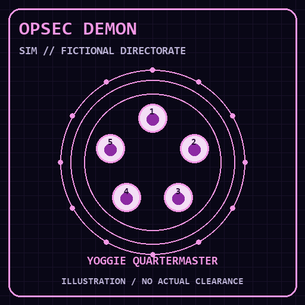
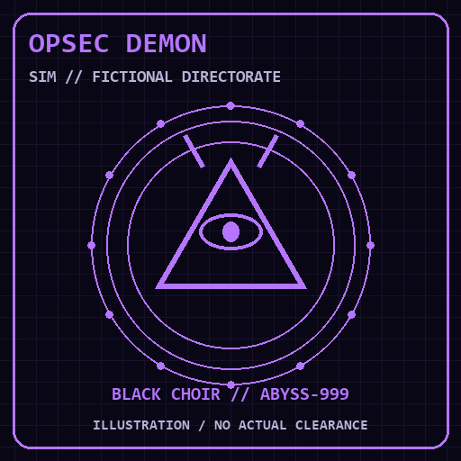

# BLACK CHOIR // Discord presence operating manual

The IPC connection is real. The clearance, rites, soul caches, party of Yoggies,
and midnight operations are explicitly fictional SIM theater.

```text
discord on YOUR_APPLICATION_ID
discord preview
discord type competing
discord display details
discord timer 900
discord load docs/discord-presence.example.json
discord art https://YOUR_PUBLIC_HOST/discord
discord off
```

The example profile uses static application asset keys. Upload the PNG
illustrations in `docs/assets/discord/` to your application's Rich Presence
asset library under their filename stems. For animation, host the GIFs at a
public HTTPS location and use `discord art` with that directory's URL. The
shell does not upload, publish, or run an asset server. A local file path or
`localhost` URL is not accessible to Discord's media proxy. The GitHub raw URL
works only after the assets have actually been pushed to that public repository.





These are original illustrations, not certificates, hardware readings, or
security guarantees. Rebuild the five GIF/PNG pairs with
`python scripts/render-discord-art.py` using Pillow. Runtime presence needs no
Python or Pillow. Each GIF loops 24 frames; rotation between illustrations
follows the 15-second presence cadence, independently of GIF playback.

## Every writable presence field

`discord load FILE` accepts a JSON object with `activity`, `large_images`, and
`small_images`. The image arrays contain up to 32 static application asset
keys/IDs or public HTTPS image URLs. Empty arrays disable automatic image
rotation. An explicit image in `activity.assets` takes precedence over its
rotation; `discord art` restores rotation using the hosted pack. Loading a
profile replaces the previous profile rather than retaining old fields.

Set `DISCORD_PRESENCE_PROFILE` to an absolute JSON file path to load that profile
at startup, including in the native Windows desktop. A rejected startup profile
prevents presence from turning on until `discord load FILE` or `discord reset`
repairs it. Keep signed image URLs in an ignored local `.env.*` profile file;
Discord attachment signatures can expire and then require a fresh image URL.

| Field | Behavior |
| --- | --- |
| `type` | Playing `0`, Listening `2`, Watching `3`, Competing `5`; command aliases accept their names |
| `status_display_type` | Name `0`, State `1`, Details `2`; controls member-list text |
| `details`, `state` | Up to 128 characters; automatic SIM prefix remains mandatory |
| `details_url`, `state_url` | Clickable text links, public HTTPS, up to 512 characters |
| `timestamps.start`, `.end` | Absolute Unix seconds for local IPC; elapsed timer, countdown, or progress bar where Discord displays it |
| `assets.large_image`, `.small_image` | Static asset keys/IDs or external GIF, animated WebP, AVIF, PNG/JPEG/WebP URLs |
| `assets.large_text`, `.small_text` | Up to 128 characters of hover text |
| `assets.large_url`, `.small_url` | Clickable illustration links |
| `assets.invite_cover_image` | Optional invite-banner asset; it needs a working invite flow to appear |
| `party.id`, `.size`, `.privacy` | Party identifier, `[current, maximum]`, optional private `0` or public `1`; default count represents available SIM Yoggies, not people |
| `secrets.join`, `.spectate`, `.match` | Optional external game's session identifiers, up to 128 characters; preview redacts them |
| `instance` | Whether this represents an instanced game session; false by default |
| `flags` | Nine-bit activity mask; zero by default |
| `buttons` | Up to two `{label, url}` objects; labels 1–32 characters and HTTPS URLs up to 512 |

The flags are INSTANCE `1`, JOIN `2`, SPECTATE `4`, JOIN_REQUEST `8`, SYNC `16`,
PLAY `32`, PARTY_PRIVACY_FRIENDS `64`, PARTY_PRIVACY_VOICE_CHANNEL `128`, EMBEDDED
`256`. Exposing these wire fields does not implement those game/social flows.
This shell has no multiplayer server, join/spectate callback handler, or
protocol registration: it never invents functioning invitations. Leave secrets
absent and social flags unset unless a separate integration supplies the
actual session behavior. Do not put credentials in these fields or commit
profiles containing actual session identifiers; use an ignored `.env.*` file
for a private JSON profile if needed (it is read only by `discord load`).

Streaming type `1` and custom-status type `4` are unavailable through
`SET_ACTIVITY`. Custom-status emoji, activity creation time, application ID,
and the application name are not writable fields for this local presence.
The application name comes from the Developer Portal. Discord assigns its
own timestamps/IDs for received events; do not copy a gateway activity object
wholesale into a profile. Uploaded assets do not animate; **external GIFs do**.
See the official [RPC field and type documentation](https://discord.com/developers/docs/topics/rpc#setactivity)
and [activity asset and button documentation](https://discord.com/developers/docs/events/gateway-events#activity-object-activity-asset-image).

## Live SIM theater and clocks

The default profile carries two manual buttons, linked details/state and
illustrations, rotating asset keys, member-list details, dynamic hover text,
elapsed time, and a SIM Yoggie party counter. Details alternate between
black-choir transmissions and the shell's actual simulated Yoggies tray,
Golden Goose egg, SDVX combo, stage/pedal/headphones, expansion bank, ritual,
SSD prop, and mission. Persona, mascot, mission, scene, and operation count
feed the card. The TUI refreshes this snapshot once a second; the worker sends
it every 15 seconds without blocking rendering or exposing commands or paths.
Line-shell snapshots refresh after commands and when inspecting presence.

`discord timer SECONDS` starts a fixed SIM countdown of 1–86400 seconds, without
resetting it each update. Listening/Watching can display a progress bar when
both endpoints are set. `discord timer elapsed` restores session elapsed time;
`discord timer off` hides the timer. Explicit profile timestamps take precedence
until a timer command replaces them. IPC timestamps use seconds, unlike the
millisecond timestamps described for gateway events. `discord reset` restores
the defaults; `discord preview` prints the generated first card without
connecting or sending anything.

Link visibility, layout, animation, buttons, and invite banners are controlled
by the Discord client and the viewer's settings; accepted payloads do not prove
that every client renders every field. Missing asset keys need portal uploads,
and hosted URLs must return an actual publicly accessible image. Live display
still requires an application ID, a desktop client, and enabled activity sharing.
